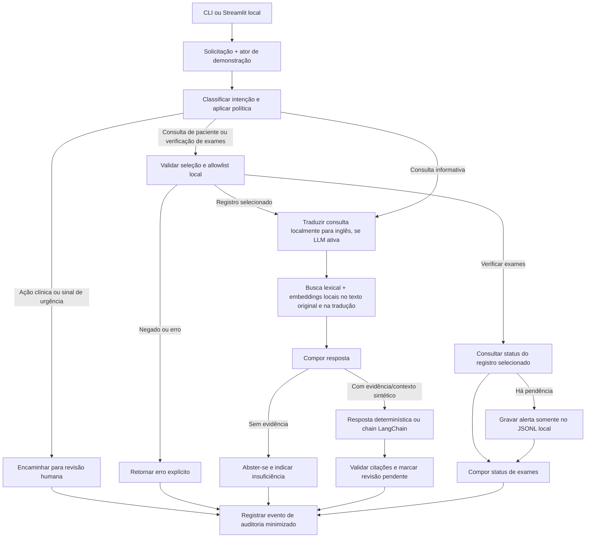

# Relatório técnico — Assistente médico (Fase 3)

## 1. Objetivo e escopo

Este relatório registra a arquitetura, a preparação de dados, o experimento de
QLoRA e as avaliações do protótipo acadêmico em Python com LangChain e
LangGraph. O sistema demonstra busca com fontes, contexto de fixtures sintéticos
e de registros locais pseudonimizados, gates de segurança e auditoria
minimizada. Não é dispositivo médico e não deve ser usado para diagnóstico,
prescrição, triagem, alertas reais ou decisões de atendimento.

## 2. Arquitetura e fluxo LangChain/LangGraph

O fluxo executável está em
[`assistant.py`](../src/medical_assistant/workflows/assistant.py). O LangGraph
classifica a solicitação e direciona consulta clínica potencialmente acionável
para revisão humana antes de chamar um modelo. Consultas de paciente exigem
seleção explícita e passam por uma allowlist local de operador único; não há
autenticação real. Dados clínicos pseudonimizados do caso selecionado são
convertidos em documentos para contextualizar uma pergunta; identificadores
diretos e nomes de profissionais não são incluídos. A busca geral não indexa
prontuários. Consultas informativas usam um retriever híbrido `BaseRetriever`,
com busca lexical e embeddings locais
[`intfloat/multilingual-e5-small`](https://huggingface.co/intfloat/multilingual-e5-small) (MIT), fixados
por revisão. As embeddings dos documentos são calculadas uma vez ao iniciar o
índice, na CPU. O índice persistido em
`artifacts/retrieval-index/embeddings.bin` é reutilizado quando o corpus e a
revisão do embedder não mudam; os pesos públicos ficam em cache local, mas
perguntas e documentos não são enviados a um serviço. A revisão do embedder é
registrada na auditoria. Com evidência, a
resposta é composta deterministicamente ou pela chain LangChain
`ChatPromptTemplate | BaseChatModel | StrOutputParser`. Sem evidência, o
assistente se abstém. As interfaces CLI e Streamlit carregam o adaptador QLoRA
PubMedQA por meio do runtime compartilhado em `application.py` e chamam o
workflow, sem chamada direta à LLM. Na consulta, depois da classificação de
segurança, o OPUS-MT local traduz a pergunta
para inglês; o retriever pesquisa tanto o texto original quanto a versão
traduzida, combinando pontuação lexical e similaridade vetorial. O prompt
solicita resposta estruturada em português, evidências e limites; a geração foi
ampliada para até 192 tokens novos. A chain responde com base nas fontes e o
OPUS-MT traduz a resposta; citações são anexadas e validadas pelo código. Os
modelos OPUS-MT 1.9 são licenciados CC BY 4.0, com atribuição mantida junto aos
artefatos locais. Tradução e busca semântica podem falhar e não têm validação
clínica.

Por padrão, o chatbot carrega o JSONL de protocolos de
`scripts/import_authorized_protocols.py` no `DocumentIndex` geral e o JSONL de
prontuários de `scripts/import_authorized_patient_records.py` em um store
separado. O índice geral também carrega os registros MedQuAD elegíveis
configurados para o runtime; a cópia fixada contém atualmente 16.423 Q&As com
resposta. A conversão executada gerou seis protocolos e 25 registros
pseudonimizados. Apenas o registro selecionado por alias é adicionado ao
contexto da consulta; não há busca cruzada entre prontuários. Campos de nome,
CPF/CNS, nascimento e profissional são omitidos, idade é agrupada e padrões
comuns são redigidos do texto livre. Isso não é anonimização completa. Os
arquivos locais não são versionados e nenhum prontuário entra no treinamento.
As referências de aprovação e privacidade são declarações fornecidas pelo
operador, sem verificação independente.

O comando `/atendimento` da CLI e a aba de atendimento sintético da interface
web oferecem uma entrevista para caso fictício, com confirmação explícita e
campos estruturados sem nome ou identificadores. Na interface web, a coleta
ocorre em turnos de chat: os campos opcionais podem ser ignorados e o resumo
exige confirmação final. A operação
`REVIEW_SYNTHETIC_CASE` passa pela política de segurança antes da recuperação;
seu prompt separado só permite listar hipóteses e exames explicitamente citados
nas fontes. A resposta fica pendente de revisão humana, e o resumo não é gravado
na auditoria. Esse fluxo é demonstrativo e não constitui diagnóstico,
solicitação de exames nem triagem clínica.

O modelo não é ativado na demonstração determinística. As interfaces interativas
exigem o adaptador QLoRA F06 e falham explicitamente se ele não puder ser
carregado; não há fallback para mock ou modelo-base. Mesmo com o adaptador
carregado, pedidos
bloqueados pela política e consultas sem evidência não chegam à geração.
Respostas geradas ficam com revisão humana pendente e citam apenas fontes
disponíveis ao workflow. O fluxo exige `AuditSink` e `AuditActor`; os eventos
registram correlação, ator/papel, intenção, estado, fontes, versões de
modelo/prompt, se a LLM foi invocada e duração, sem o texto da pergunta ou da
resposta. `translation_used` e `translation_version` identificam a aplicação
dos modelos locais de tradução sem registrar o texto traduzido.

## 3. Dados, proveniência e licenças

O manifesto de fontes está em
[`source_manifest.json`](../data/source_manifest.json).

| Fonte | Licença/proveniência registrada | Uso neste projeto |
|---|---|---|
| PubMedQA | Licença MIT do repositório; ela não estabelece, por si só, direitos sobre cada abstract ou registro subjacente. | PQA-L baixado localmente da revisão fixa registrada no manifesto; PQA-A e PQA-U não usados. |
| MedQuAD | CC BY 4.0; preservar atribuição, URL e metadados. O aviso do projeto sobre respostas removidas em subconjuntos MedlinePlus deve ser respeitado. | Cópia local fixada; três subconjuntos restritos são excluídos. Q&As respondidas são usadas no RAG do runtime e no corpus híbrido preparado. |
| OPUS-MT 1.9 | CC BY 4.0; atribuição original preservada com cada pacote local. | Tradução local português-inglês/inglês-português na CLI e na interface web; pacotes verificados por SHA-256 e ignorados pelo Git. |
| Fixtures sintéticos | Conteúdo fictício, explicitamente marcado como sintético. | Usados nos testes, demonstração e smoke test. |
| Amostra local do experimento F05 | Metadados de aprovação exercitam o contrato de ingestão; não são verificação independente. | Dez registros de protocolo, FAQ e template passaram pelo gate para fine-tuning; três registros com estrutura de prontuário foram excluídos. |
| Massa local importada em R03 | Aprovação e revisão são referências declaradas pelo operador; massa e derivados são ignorados pelo Git. | Seis protocolos vão ao RAG geral; 25 prontuários pseudonimizados ficam em store separado e só o caso selecionado entra no contexto. Não há retreinamento. |

Os importadores R03 validam a massa pelo schema e registram metadados
declarados; isso não comprova autenticidade da origem ou da autorização. O
loader de protocolos exige `contains_patient_data=false`; o store de
prontuários exige `contains_patient_data=true`, aprovação e revisão declaradas,
mas não fornece autenticação real. Os prontuários omitem campos identificadores
selecionados, agrupam idade e redigem padrões comuns do texto livre; nomes em
texto livre, fatos raros e identificadores não reconhecidos ainda exigem
revisão humana. A pseudonimização não é anonimização completa. Os dados
hospitalares não estão versionados neste repositório.
Os dez registros usados no experimento F05 são uma amostra local de demonstração
em formato de protocolo/FAQ/template, não conteúdo institucional oficial nem
registros de pacientes. A origem e a natureza clínica da massa importada em R03
não foram auditadas independentemente. Os fixtures do assistente são
explicitamente sintéticos.

O pré-processamento dos datasets públicos também preserva proveniência e
agrupamento por origem. O particionador separa grupos de origem/conteúdo para
reduzir vazamento. Os rótulos artificiais PQA-A são train-only; validação e
teste não devem ser usados para treino ou seleção de checkpoint.

A preparação do PQA-L reproduz a metade de teste oficial de 500 registros e
divide a metade de validação cruzada, com agrupamento por fonte/conteúdo e seed
42, em treino (449) e validação (51). O abstract/contexto acompanha cada exemplo
para condicionar o fine-tuning e as consultas de avaliação; o índice RAG usa
somente os contextos, não as respostas de referência. O teste oficial permanece
fora do treino, da seleção de checkpoint e da escolha de prompt. A configuração
e o manifesto locais registram hashes e revisão.

### Preparação híbrida PubMedQA + MedQuAD

O pipeline [`prepare_hybrid_training.py`](../scripts/prepare_hybrid_training.py)
combina amostras determinísticas dos dois datasets públicos com quatro exemplos
sintéticos de segurança. A revisão MedQuAD
`577bd37b96c02d1833b2c9eed2de9f96964e96cb` foi fixada e o manifesto registra o
SHA-256 do arquivo compactado. O loader preserva atribuição e metadados,
contabiliza documentos sem Q&A e respostas vazias e exclui integralmente
`10_MPlus_ADAM_QA`, `11_MPlusDrugs_QA` e
`12_MPlusHerbsSupplements_QA`, conforme o aviso do repositório. A cópia elegível
contém 16.423 Q&As; 5 respostas vazias, 6 documentos sem Q&A e 5.777 XMLs
excluídos foram contabilizados. IDs incluem origem/caminho para evitar colisões.

Os splits híbridos locais contêm 512 registros de treino (254 PubMedQA, 254
MedQuAD, 4 sintéticos), 116 de validação (51, 64, 1) e 568 de teste (500, 64,
4). A partição preserva o holdout oficial PQA-L de 500 casos para avaliação e
seleciona no máximo uma pergunta por documento MedQuAD nas amostras. O manifesto
local contém hashes dos splits e contagens; os arquivos são ignorados pelo Git.
Prontuários não entram nos pesos, e os protocolos atuais não estão marcados como
elegíveis para fine-tuning, portanto ficam no RAG.

A configuração
[`qwen2_5_0_5b_hybrid_qlora.json`](../training/configs/qwen2_5_0_5b_hybrid_qlora.json)
define QLoRA NF4 por 100 passos, com seleção do checkpoint pela loss de
validação. O treinamento foi concluído em 5.266 s, com `train_loss=1,640526`;
`eval_loss` diminuiu de 1,898273 no passo 25 para 1,763530 no passo 100. O
runner constrói o índice RAG de avaliação somente com documentos dos splits
de treino, evitando que os documentos de teste sejam recuperados diretamente.
No teste híbrido de 568 registros, Token F1 foi 0,055834 para RAG e 0,047350
para fine-tuning + RAG; o resultado por origem e as limitações estão em
[`avaliacao.md`](./avaliacao.md). Como houve regressão no agregado e em MedQuAD,
o novo adaptador não foi selecionado para o runtime, que permanece no adaptador
PubMedQA anterior. O resumo local está em
`artifacts/qwen2_5_0_5b_hybrid_qlora/experiment_summary.json` e os artefatos
estão ignorados pelo Git.

## 4. Fine-tuning

O modelo-base do experimento interno foi
`Qwen/Qwen2.5-0.5B-Instruct`, revisão
`7ae557604adf67be50417f59c2c2f167def9a775`, com licença Apache-2.0 registrada
na configuração
[`qwen2_5_0_5b_internal_qlora.json`](../training/configs/qwen2_5_0_5b_internal_qlora.json).
Foi usado QLoRA NF4 de 4 bits, double quantization, LoRA rank 8, alpha 16,
dropout 0,05, seed 42, sequência máxima de 512 tokens, batch por dispositivo
1, acumulação de gradiente 8, learning rate `2e-4` e 100 passos. O runner fixa
o treino no split `train`, usa `validation` durante o ajuste e consulta o split
`test` somente após o treinamento para avaliação.

O experimento institucional local completou em aproximadamente 26 minutos na
GTX 1650 com 4 GiB. Os splits tinham 7 exemplos de treino, 1 de validação e 2
de teste. A loss média reportada no treino foi 0,2730; a loss de validação foi
3,6789 no passo 50 e 3,6817 no passo 100. A loss de treino chegou a
aproximadamente 0,0004 no passo 100, enquanto a validação não melhorou, o que
é consistente com sobreajuste. O tamanho do corpus não sustenta generalização.

O resumo detalhado e o adaptador são locais em
`artifacts/qwen2_5_0_5b_internal_qlora/`, diretório ignorado pelo Git. O resumo
contém hashes de configuração e splits para rastreabilidade; não contém uma
alegação de validade clínica. O smoke test separado usa apenas fixtures
sintéticos e um passo.

### Experimento público PubMedQA (PQA-L)

A configuração separada
[`qwen2_5_0_5b_pubmedqa_qlora.json`](../training/configs/qwen2_5_0_5b_pubmedqa_qlora.json)
usa Qwen2.5-0.5B-Instruct na revisão fixada, QLoRA NF4, rank 8, 100 passos,
seed 42, sequência máxima de 512 tokens, batch por dispositivo 1 e acumulação
de gradiente 8. O treino é limitado aos 449 registros de treino; os 51 da
validação são usados pelo trainer e os 500 registros oficiais de teste ficam
fora do treino e da seleção de checkpoint. O contexto dos abstracts é incluído
no ajuste e nas predições do modelo.

Na execução histórica F06, o índice RAG local incluiu abstracts dos 1.000
registros PQA-L, inclusive os 500 casos de teste; respostas de referência não
foram indexadas. Portanto, as métricas reportadas para essa execução medem
recuperação dentro do corpus conhecido e não constituem estimativa independente
de generalização. O runner foi atualizado para limitar o índice RAG dos
experimentos futuros aos documentos de treino; isso não altera
retroativamente os resultados F06. Token F1 mede sobreposição lexical, não
correção semântica ou clínica. PQA-L público também não substitui protocolos
hospitalares autorizados.

A execução F06 foi concluída em 2026-11-22 com QLoRA de 100 passos. A loss de
validação registrada no checkpoint foi 2,0741 no passo 50 e 2,0804 no passo
100. O resumo e o adaptador ficam localmente em
`artifacts/qwen2_5_0_5b_pubmedqa_qlora/`; a configuração permite retomar do
`checkpoint-100` para concluir a avaliação sem repetir os passos de treino.

## 5. Avaliação e análise dos resultados

A avaliação sintética inicial compara modelo-base, gate de segurança, RAG e
fine-tuning + RAG em quatro casos congelados. Seus resultados e erros
representativos estão em [`avaliacao.md`](./avaliacao.md). As métricas são
checagens técnicas pequenas: Token F1 mede sobreposição lexical e a
classificação comportamental é baseada em regras.

No experimento institucional, o teste tinha apenas dois registros:

| Sistema | Casos | Token F1 médio |
|---|---:|---:|
| Modelo-base bruto (diagnóstico) | 2 | 0,255555 |
| Modelo-base com gate de segurança | 2 | 0,040185 |
| RAG | 2 | 0,040185 |
| Fine-tuning + RAG | 2 | 0,040185 |

As métricas de comportamento esperado e de fonte/citação não se aplicam porque
os dois registros não têm esses rótulos de avaliação. Além disso, o runner
constrói o índice RAG com os documentos sintéticos da demonstração; ele não
indexa o corpus hospitalar. Portanto, esses resultados não avaliam recuperação
RAG sobre protocolos institucionais. Com dois casos, não há base estatística
para comparar sistemas, e os valores não medem correção clínica, segurança ou
eficácia. A igualdade das três variantes com gate/RAG não demonstra
equivalência entre os modelos.

No holdout PQA-L de 500 casos, Token F1 foi 0,118513 no modelo-base bruto,
0,017366 no modelo-base com gate, 0,200031 no RAG e 0,218834 em fine-tuning +
RAG. Recall/citação da fonte esperada foi 0,802 nos três sistemas com gate e
validade das citações foi 1,000. Esses valores e as limitações estão detalhados
em [`avaliacao.md`](./avaliacao.md); a inclusão dos abstracts de teste no índice
RAG impede interpretar as métricas de recuperação como generalização
independente. A avaliação não demonstra qualidade clínica.

Uma execução da CLI com o adaptador real confirmou `model_invoked=true` e
fontes de fixture sintético na auditoria minimizada. A resposta gerada à
pergunta sobre exames foi genérica; `/exames` apresentou os estados sintéticos
estruturados e gerou apenas um alerta local simulado aguardando revisão. Foram
validados sete cenários hospitalares sintéticos, todos aprovados; não houve
envio externo. Isso confirma a execução do fluxo, não precisão clínica.

As interfaces também traduzem localmente perguntas em português para inglês
antes da busca PubMedQA e traduzem a resposta gerada para português com modelos
OPUS-MT. A busca inclui a pergunta original para preservar resultados de
fixtures sintéticos em português. Nenhum serviço de terceiros recebe a
consulta; a tradução ainda não foi avaliada com métricas próprias nem validada
por profissionais.

## 6. Segurança, validação e limitações

- A política de segurança por palavras-chave encaminha pedidos de prescrição,
  diagnóstico e ações clínicas para revisão; ela é heurística, não triagem
  clínica, e não garante detecção de todos os pedidos.
- Sinais reconhecidos como urgentes recebem orientação para acionar a equipe
  conforme o protocolo local. A verificação de exames pode gravar um evento de
  alerta sintético em JSONL local, sempre aguardando revisão humana; nenhum
  alerta é enviado a uma equipe ou sistema externo e nenhuma ordem é executada.
- O armazenamento é somente leitura e combina fixtures sintéticos com arquivos
  pseudonimizados locais autorizados. Não há integração com prontuário ou banco
  hospitalar real; a identidade fixa da demonstração não é autenticação real.
- A interface Streamlit é opcional, vinculada a `127.0.0.1`, sem telemetria de
  uso e sem autenticação. O histórico e resultados ficam na sessão do navegador;
  os cartões de fontes não apresentam trechos nem metadados de prontuário.
- Respostas geradas exigem revisão profissional; o prompt restringe a geração
  à evidência e solicita citações, e o código valida citações contra fontes
  recuperadas. Isso não elimina alucinações.
- Logs não persistem o texto clínico integral por padrão. Retenção, controle de
  acesso, identidade confiável e infraestrutura de auditoria de produção não
  foram implementados.
- Os testes automatizados verificam gates, autorização sintética, abstinência,
  citações, metadados, splits e rastreabilidade; não certificam segurança
  clínica ou anonimização.
- Os sete cenários congelados de contexto hospitalar sintético passaram; a
  suíte completa teve 158 testes aprovados, com um aviso futuro de PEFT/
  Transformers. O smoke test de navegador
  registrado antes da integração MedQuAD carregou o runtime local, exibiu seis
  protocolos e 25 registros e confirmou as três abas; nenhuma consulta clínica
  foi enviada. A integração e o cache do índice têm testes de runtime com
  dependências simuladas; um AppTest com runtime falso percorreu a entrevista
  conversacional e confirmou que ela não envia contexto de prontuário. A
  validação real da CLI confirmou invocação do adaptador, sem enviar alertas
  externos.
- Benchmark de indexação fria do corpus completo: 1.000 registros PubMedQA,
  16.423 MedQuAD, seis protocolos e dois documentos sintéticos produziram
  39.930 chunks, sem chunks de prontuário. A construção com embeddings na CPU
  levou 4.137,08 s (68 min 57 s); o RSS passou de 127,2 MiB para 2.207,5 MiB
  (+2.080,3 MiB). A geração do cache completo levou 4.108,67 s (68 min 29 s),
  gerou um arquivo local de 61.332.625 bytes e não indexou prontuários. Com o
  cache, a construção dos mesmos 39.930 chunks levou 15,69 s e acrescentou
  850,0 MiB de RSS; a verificação usou um embedder que gera erro se tentar
  recalcular embeddings. Essas medidas cobrem a construção do índice depois de
  carregar dados e embedder, não o runtime completo. O cache é ignorado pelo Git
  e só é reutilizado quando a fingerprint dos textos e a revisão do embedder
  coincidem;
  após alterações nesses dados, a próxima inicialização volta a ter o custo da
  primeira geração.
- O experimento institucional demonstrou execução técnica, mas mostrou
  sobreajuste. O adaptador não está aprovado para implantação ou uso
  assistencial.

## 7. Reprodução

As instruções de ambiente, demonstração sintética, preparação/revisão de dados,
testes e comandos estão no [`README.md`](../README.md). Depois de preparar
PubMedQA PQA-L, instalar as dependências CUDA e produzir o adaptador F06, a CLI
pode ser iniciada com
`.\.venv\Scripts\python.exe scripts\chatbot_assistente.py`. Para instalar a
interface web opcional use
`.\.venv\Scripts\python.exe -m pip install -e ".[ui]"` e execute
`.\.venv\Scripts\python.exe -m streamlit run scripts\chatbot_web.py`. Ambas
usam o runtime local, não exigem credenciais hospitalares e gravam auditoria
minimizada e alertas apenas simulados. A interface web fica restrita a
`127.0.0.1`; não a exponha na rede. O experimento F05 requer que os três splits
locais estejam presentes; seus metadados de aprovação são apenas demonstrativos,
não autorização de uma instituição real. Os experimentos podem ser reavaliados
pela leitura de
`artifacts/qwen2_5_0_5b_internal_qlora/experiment_summary.json`; os caminhos de
dados e artefatos locais não devem ser adicionados ao Git.
